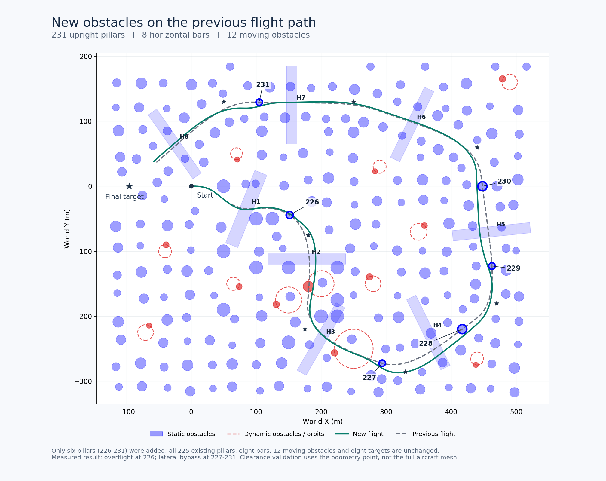
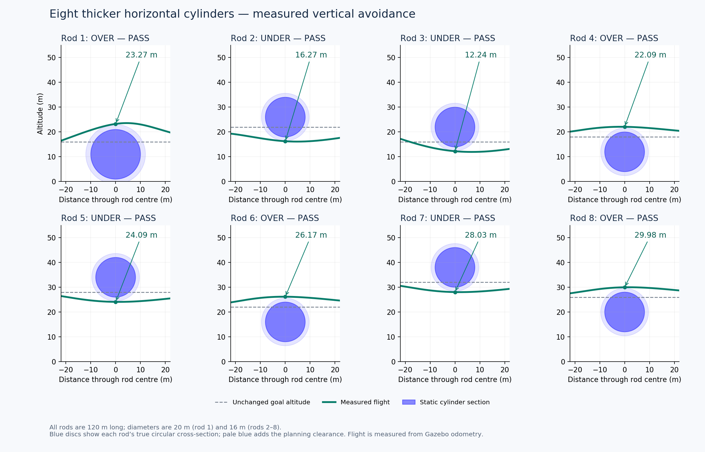

# Two-Phase Motion Planning for Fixed-Wing UAVs

A ROS 1 research workspace for fixed-wing UAV motion planning in cluttered environments. The current simulation demo uses a receding-horizon library of **3D motion primitives** to select collision-checked flight commands, with matching obstacle geometry in **Gazebo Classic** and **RViz**.

The repository retains the original ROSplane/MAVROS files and all scene presets developed during the 3D experiments. The quick start below uses the bundled `simple-airplane` simulator and the `motion_primitives_planning` package.

## Simulation demo

The animation shows the fixed-wing UAV navigating the 3D obstacle field, with RViz on the left and Gazebo on the right.


## Scene overview



The solid green line is the measured flight after adding six pillars directly on the previous flight path; the dashed gray line is the previous flight. Labels 226–231 identify the new pillars. All existing obstacles and all eight target waypoints remain unchanged.

## Features

- Up to **203 candidate primitives** per planning cycle: 29 heading samples × 7 altitude layers.
- Model-based trajectory rollouts with climb, descent, turning, and actuator response.
- Collision checks for finite-height upright cylinders, spheres, oriented horizontal cylinders, and predicted moving obstacles.
- One launch file starts Gazebo, RViz, the planner, and dynamic-obstacle synchronization.
- **Blue static obstacles** and **red dynamic obstacles** in both interfaces. Green lines show candidate trajectories.
- Scene observers that verify vertical passages and obstacle motion without commanding the aircraft.

The default full-area scene contains **231 upright cylinders, 8 horizontal cylinders, and 12 moving cylinders**. Obstacles cover a rectangle spanning **X = −130 to 530 m** and **Y = −330 to 200 m**, including areas outside the flight route. The eight horizontal cylinders are 120 m long; the first has a 20 m diameter and the others have 16 m diameters.

Pillars 226–231 were added on the previously measured flight path to break up the open corridor. They comprise three 58 m pillars and three lower pillars measuring 18.5, 20.5, and 30.5 m. In the updated validation flight, the UAV flew over pillar 226 and passed laterally around pillars 227–231. The original 225 upright cylinders, eight horizontal cylinders, twelve moving obstacles, and all waypoint coordinates and altitudes are unchanged.

## Tested environment

| Component | Tested version |
| --- | --- |
| Operating system | Ubuntu 20.04.6 LTS |
| ROS | ROS 1 Noetic |
| Simulator | Gazebo Classic 11.15.1 |
| Visualization | RViz for ROS Noetic |
| Python | Python 3 with PyYAML |

These launch files target ROS 1 and Gazebo Classic. ROS 2 and the newer Gazebo simulator are not covered by this setup.

## Build

Start with an installed ROS Noetic environment. Install the demo dependencies:

```bash
sudo apt update
sudo apt install -y build-essential git python3-yaml \
  ros-noetic-catkin ros-noetic-gazebo-ros-pkgs \
  ros-noetic-robot-state-publisher ros-noetic-xacro \
  ros-noetic-rviz ros-noetic-tf ros-noetic-rostest
```

Clone the repository **inside the `src` directory of a catkin workspace**:

```bash
mkdir -p ~/two_phase_ws/src
cd ~/two_phase_ws/src
git clone https://github.com/HKPolyU-UAV/Two-phase-motion-planning.git

source /opt/ros/noetic/setup.bash
cd ~/two_phase_ws
catkin_make -j2 \
  -DCATKIN_WHITELIST_PACKAGES="motion_primitives_planning;simple_airplane_plugins;simple_airplane_gazebo;simple_airplane_description"
source devel/setup.bash
```

The whitelist builds the four packages used by these demos. The retained `rosplane/` and `mavros_launch/` directories belong to the earlier integration and have additional dependencies, including ROSflight and MAVROS; they are not required for this quick start. Do not replace the whitelist with a whole-workspace build unless those dependencies are installed.

The planner enables `-O2` for the default single-configuration build when no build type is specified. Explicit Debug/Release settings remain under your control. This matters when running the large obstacle field.

## Run the full-area scene

In a terminal sourced for the workspace you just built:

```bash
source ~/two_phase_ws/devel/setup.bash
roslaunch motion_primitives_planning motion_primitives_3d_horizontal.launch
```

1. Wait for Gazebo and RViz to open.
2. Click **Play** in Gazebo. The simulation starts paused by default.
3. Observe the UAV turn, climb, and descend through the course. The red obstacles move in both Gazebo and RViz.
4. Press **Ctrl+C in the launch terminal** to stop the complete session. Wait for its child processes to exit before starting another scene.

This combined launch already starts both interfaces; a separate Gazebo or planner launch is unnecessary.

For a run without either graphical interface:

```bash
roslaunch motion_primitives_planning motion_primitives_3d_horizontal.launch \
  gui:=false rviz:=false paused:=false
```

## Preserved scene presets

Each entry below is a complete Gazebo + RViz launch. Stop the previous session before switching presets.

| Preset | Launch file | Static geometry | Moving obstacles |
| --- | --- | --- | ---: |
| Original layout | `motion_primitives_original.launch` | 12 upright cylinders | 3 |
| Vertical-avoidance validation | `motion_primitives_3d_validation.launch` | 38 upright cylinders | 0 |
| Complex 3D course | `motion_primitives_3d_complex.launch` | 58 upright cylinders | 3 |
| Floating-sphere experiment | `motion_primitives_3d_spheres_original.launch` | 12 upright cylinders + 3 spheres | 3 |
| Three long horizontal cylinders | `motion_primitives_3d_horizontal_thin.launch` | 12 upright cylinders + 3 horizontal cylinders, 220 m long | 3 |
| Eight thick horizontal cylinders | `motion_primitives_3d_horizontal_eight.launch` | 12 upright cylinders + 8 horizontal cylinders, 120 m long | 3 |
| Dense route corridor | `motion_primitives_3d_horizontal_corridor.launch` | 94 upright cylinders + 8 horizontal cylinders | 3 |
| **Full-area obstacle field — default** | **`motion_primitives_3d_horizontal.launch`** | **231 upright cylinders + 8 horizontal cylinders** | **12** |

For example:

```bash
roslaunch motion_primitives_planning motion_primitives_3d_horizontal_eight.launch
```

The original layout is preserved as a scene and uses the current 3D planner. The sphere experiment is retained for comparison: a sphere permits lateral detours, while a long horizontal cylinder makes vertical passage easier to demonstrate.

**Compatibility alias:** `motion_primitives_3d_spheres.launch` still opens the default full-area horizontal-cylinder scene, matching the previous workflow. Use `motion_primitives_3d_spheres_original.launch` to load the actual spheres.

## Configuration and world generation

| Location | Purpose |
| --- | --- |
| `motion_primitives_planning/launch/config/mp.yaml` | Primitive sampling, flight-model parameters, limits, and cost weights |
| `motion_primitives_planning/launch/config/task*.yaml` | Obstacle dimensions/motion, waypoints, and scene-validation settings |
| `simple-airplane/simple_airplane_gazebo/worlds/` | Gazebo worlds matching the scene configurations |
| `motion_primitives_planning/scripts/generate_*.py` | Deterministic world-generation utilities |
| `motion_primitives_planning/src/motion_primitives.h` | Planning, prediction, collision checks, and visualization |

Positions and dimensions are in meters. Waypoint `h` is altitude. An upright cylinder uses `r`, `height`, and optional center height `z`; without `z`, its center is at half its height. A horizontal cylinder uses `x`, `y`, `z`, `r`, `length`, and `axis_yaw` in **degrees**. Circular dynamic obstacles use `center`, orbit `radius`, and `angular_velocity` in **radians per second**.

Keep each task configuration and its Gazebo world together. After changing static geometry in the full-area task, regenerate its world:

```bash
planner_pkg="$(rospack find motion_primitives_planning)"
gazebo_pkg="$(rospack find simple_airplane_gazebo)"
python3 "$planner_pkg/scripts/generate_horizontal_world.py" \
  --base-world "$gazebo_pkg/worlds/obs.world" \
  --task-config "$planner_pkg/launch/config/task_3d_horizontal.yaml" \
  --output "$gazebo_pkg/worlds/horizontal_obstacles.world"
```

Use the corresponding preset configuration and output filename when regenerating an archived horizontal scene. The sphere and vertical-course generators expose the same `--base-world`, `--task-config`, and `--output` arguments. Moving models are created and positioned by `gazebo_dynamic_obstacles.py` from the planner's published markers; their motion is not integrated independently in Gazebo.

The horizontal-world generator preserves the original twelve Gazebo columns and adds later columns from the task file. Those original Gazebo columns use their saved geometry, while the task configuration contains conservative planning radii. If editing an original column, update the base world as well as its planning configuration.

Changes to `.cpp` or `.h` files require rebuilding and restarting the nodes. YAML, launch, RViz, and world-file changes require restarting the relevant session; world geometry must also be regenerated when its source configuration changes.

## Validation

Build and run the geometry/model test suite:

```bash
cd ~/two_phase_ws
source devel/setup.bash
catkin_make motion_primitives_3d_test -j2
rostest motion_primitives_planning motion_primitives_3d.test
```

The current suite contains **19 tests**, covering 3D sampling, finite obstacle geometry, oriented cylinders, trajectory collision checks, visualization, and vertical avoidance behavior.

Horizontal-cylinder presets enable a read-only observer by default. After playback has completed the validation route, inspect:

```bash
rosparam get /suav1/verify_horizontal_avoidance/passed
rosparam get /suav1/verify_horizontal_avoidance/summary
```

The `passed` parameter is created when validation finishes; it is absent while the run is still pending. The observer checks that all configured horizontal cylinders are crossed vertically away from their ends, both upward and downward passages occur, moving obstacles are observed moving, and the final target is approached within the configured tolerances. Set `verify:=false` on a validation preset to disable its observer.

In the development environment, the updated full-area scene completed its validation in approximately **95 simulated seconds**, with **12 moving obstacles synchronized** and an observed planning publication rate of approximately **8.3 Hz** with both graphical interfaces disabled. These measurements describe that run; timing depends on hardware, rendering load, and configuration. All eight horizontal-cylinder passages passed, and the recorded flight cleared all six added pillars. A comparison of the configurations and generated worlds confirmed that every pre-existing obstacle and target remained unchanged. See the [updated validation measurements](docs/validation/full-area-route-blockers.json). The checks use the **odometry point with configured obstacle margins**, not the full aircraft mesh or wingspan.



## Simulator interface

The planner and bundled flight plugin share a custom message convention:

- `/suav1/cmd_vel` uses `geometry_msgs/Twist`, with `linear.x` carrying the roll command, `linear.y` the angle-of-attack command, and `linear.z` the thrust command. These fields are **not Cartesian velocity commands**.
- `/suav1/odom` publishes pose and simulator state. Its twist fields encode airspeed, flight-path angle, heading, thrust, and heading rate rather than a standard Cartesian velocity vector.
- `/suav1/obs`, `/suav1/traj`, and `/suav1/goal` publish the obstacle, candidate-trajectory, and active-goal markers used by RViz.

Keep the planner and simulator plugin together when adapting this interface to another controller.

## Troubleshooting

- **“Launch file not found”:** source the intended workspace's `devel/setup.bash`, then check `rospack find motion_primitives_planning`. Running from a `src` directory alone does not select a ROS workspace.
- **Nothing moves:** click Gazebo's Play button, or launch with `paused:=false`. Nodes using simulation time wait while physics is paused.
- **Unexpected scene or duplicated aircraft:** stop the previous launch completely, then start one combined scene. The supplied worlds already contain `suav1`.
- **Obstacle changes appear only in RViz:** regenerate the matching static world and restart. Confirm that the dynamic-obstacle bridge is running for moving models.
- **Slow large scenes:** use the default optimized build or an explicit Release build; try `gui:=false rviz:=false` to separate planning cost from rendering cost.

## Repository layout and attribution

```text
motion_primitives_planning/   Planner, scene configurations, validators, and tests
simple-airplane/              Bundled simulator packages, meshes, plugin, and worlds
rosplane/                     Retained earlier ROSplane integration
mavros_launch/                Retained earlier MAVROS launch files
docs/images/                  Scene and validation figures
docs/validation/              Recorded validation measurements
```
